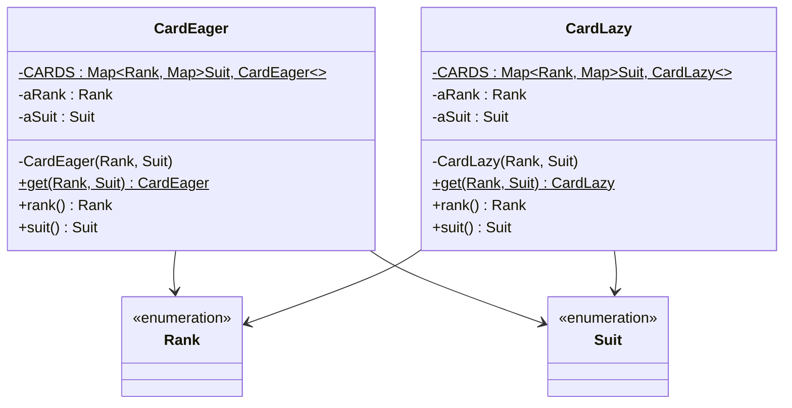
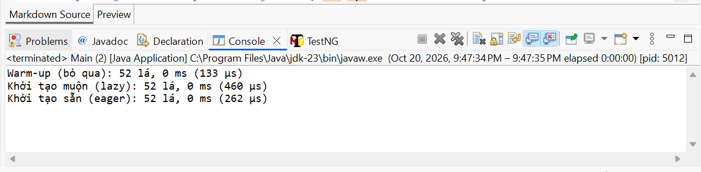

# Lab 05 – Exercise 8: Khởi tạo muộn cho Flyweight (Card)

| | |
|---|---|
| **Họ và tên** | Lê Anh Khoa |
| **MSSV** | 4651050119 |
| **Lớp** | 46D |
| **Bài** | Lab 05 – Exercise 8 (Chapter 4, *Introduction to Software Design with Java*) |

---

## 1. Đề bài

> Sửa code đã viết ở Exercise 9 sao cho các flyweight của lá bài được **khởi tạo muộn** (lazy). Dùng `System.currentTimeMillis()` để so sánh thời gian lấy đủ 52 lá bài của hai cách. Rút ra kết luận gì?

Yêu cầu của Lab: **thực hành và giải thích giải pháp**.

---

## 2. Giải pháp

Em viết hai lớp `Card` cùng dùng mẫu Flyweight, khác nhau ở **thời điểm tạo lá bài**:

| Lớp | Cách tạo | Khi nào 52 lá được tạo |
|-----|----------|------------------------|
| `CardEager` | Khởi tạo sẵn (eager) | Ngay khi lớp được nạp, trong khối `static` |
| `CardLazy` | Khởi tạo muộn (lazy) | Chỉ khi có người gọi `get(rank, suit)` cho lá đó |

Cả hai đều dùng `IdentityHashMap` lồng nhau `Map<Rank, Map<Suit, Card>>` làm kho flyweight, nên điểm khác duy nhất là thời điểm tạo. Nhờ vậy phép so sánh thời gian mới công bằng.



### 2.1. `CardEager` – khởi tạo sẵn

```java
package lab05;

import java.util.IdentityHashMap;
import java.util.Map;

import e3.chapter3.Rank;
import e3.chapter3.Suit;

public final class CardEager {

    private static final Map<Rank, Map<Suit, CardEager>> CARDS = new IdentityHashMap<>();

    // Tạo sẵn đủ 52 lá khi lớp được nạp
    static {
        for (Rank r : Rank.values()) {
            Map<Suit, CardEager> innerMap = new IdentityHashMap<>();
            for (Suit s : Suit.values()) {
                innerMap.put(s, new CardEager(r, s));
            }
            CARDS.put(r, innerMap);
        }
    }

    private final Rank aRank;
    private final Suit aSuit;

    private CardEager(Rank pRank, Suit pSuit) {
        assert pRank != null && pSuit != null;
        aRank = pRank;
        aSuit = pSuit;
    }

    public static CardEager get(Rank pRank, Suit pSuit) {
        assert pRank != null && pSuit != null;
        return CARDS.get(pRank).get(pSuit);
    }

    public Rank rank() { return aRank; }
    public Suit suit() { return aSuit; }

    @Override
    public String toString() { return aRank + " of " + aSuit; }
}
```

### 2.2. `CardLazy` – khởi tạo muộn

```java
package lab05;

import java.util.IdentityHashMap;
import java.util.Map;

import e3.chapter3.Rank;
import e3.chapter3.Suit;

public final class CardLazy {

    private static final Map<Rank, Map<Suit, CardLazy>> CARDS = new IdentityHashMap<>();

    private final Rank aRank;
    private final Suit aSuit;

    private CardLazy(Rank pRank, Suit pSuit) {
        assert pRank != null && pSuit != null;
        aRank = pRank;
        aSuit = pSuit;
    }

    public static CardLazy get(Rank pRank, Suit pSuit) {
        assert pRank != null && pSuit != null;
        Map<Suit, CardLazy> innerMap = CARDS.getOrDefault(pRank, new IdentityHashMap<>());
        CARDS.putIfAbsent(pRank, innerMap);
        if (!innerMap.containsKey(pSuit)) {
            innerMap.put(pSuit, new CardLazy(pRank, pSuit));   // chỉ tạo khi có người xin
        }
        return innerMap.get(pSuit);
    }

    public Rank rank() { return aRank; }
    public Suit suit() { return aSuit; }

    @Override
    public String toString() { return aRank + " of " + aSuit; }
}
```

`CardLazy` dựa theo lời giải mẫu của sách: lá bài chỉ được thêm vào kho flyweight khi có yêu cầu.

---

## 3. Chương trình đo thời gian

```java
package lab05;

import java.util.function.BiFunction;

import e3.chapter3.Rank;
import e3.chapter3.Suit;

public class Main {

    private static void measure(String name, BiFunction<Rank, Suit, Object> source) {
        long startMs = System.currentTimeMillis();
        long startNs = System.nanoTime();
        int count = 0;
        for (Rank r : Rank.values()) {
            for (Suit s : Suit.values()) {
                source.apply(r, s);
                count++;
            }
        }
        long ms = System.currentTimeMillis() - startMs;
        long us = (System.nanoTime() - startNs) / 1000;
        System.out.println(name + ": " + count + " lá, " + ms + " ms (" + us + " µs)");
    }

    public static void main(String[] args) {
        // Khởi động trước để không tính thời gian nạp Rank, Suit và lambda vào kết quả
        measure("Warm-up (bỏ qua)", (r, s) -> r);
        
        measure("Khởi tạo muộn (lazy)", CardLazy::get);
        measure("Khởi tạo sẵn (eager)", CardEager::get);
    }
}
```

Một số lưu ý về cách đo:

- Em đo bằng `System.currentTimeMillis()` đúng như đề. Vì 52 đối tượng quá nhỏ nên kết quả chỉ ra 0, 1 hoặc 2 ms, quá thô để so sánh. Em đo thêm bằng `System.nanoTime()` và đổi ra micro giây (µs) để thấy rõ sự khác biệt.
- Có một lượt chạy khởi động (warm-up) trước để thời gian nạp lớp `Rank`, `Suit` không bị tính vào kết quả của cách nào.
- Với `CardEager`, lần gọi `get` đầu tiên sẽ nạp lớp và chạy khối `static`, nên chi phí tạo 52 lá nằm trong khoảng thời gian đo.
- Em chạy **8 lần**: 5 lần với thứ tự eager → lazy, rồi đảo thành lazy → eager (như code `main` ở trên) và chạy 3 lần, để kiểm tra kết quả không phụ thuộc cái nào chạy trước.

---

## 4. Kết quả

Thời gian lấy đủ 52 lá bài (đơn vị µs, trong ngoặc là số ms mà `currentTimeMillis()` cho ra):

| Lần | Thứ tự chạy | Eager | Lazy |
|:---:|-------------|:-----:|:----:|
| 1 | eager → lazy | 226 (0 ms) | 494 (1 ms) |
| 2 | eager → lazy | 174 (0 ms) | 497 (1 ms) |
| 3 | eager → lazy | 280 (0 ms) | 1691 (2 ms) |
| 4 | eager → lazy | 261 (0 ms) | 903 (1 ms) |
| 5 | eager → lazy | 275 (0 ms) | 284 (0 ms) |
| 6 | lazy → eager | 329 (1 ms) | 406 (0 ms) |
| 7 | lazy → eager | 191 (0 ms) | 398 (0 ms) |
| 8 | lazy → eager | 262 (0 ms) | 460 (0 ms) |
| | **Trung bình** | **250** | **642** |
| | **Trung vị** | **262** | **477** |

Ảnh chụp console một lần chạy (thứ tự lazy → eager):



---

## 5. Nhận xét và kết luận

**Nhận xét:**

- Eager nhanh hơn lazy ở **cả 8 lần đo**, kể cả khi lazy được chạy trước, nên kết quả không phụ thuộc thứ tự chạy.
- Theo trung vị, lazy chậm hơn eager khoảng **1,8 lần** (477 so với 262 µs). Trung bình lệch nhiều hơn vì lần 3 của lazy có giá trị bất thường (1691 µs), có thể do nhiễu hệ thống hoặc GC, nên em ưu tiên trung vị hơn.
- Chênh lệch tuyệt đối rất nhỏ, chỉ vài trăm µs, dưới 2 ms.

**Vì sao lazy chậm hơn?** Cả hai cách đều tạo đúng 52 đối tượng, nên phần tạo đối tượng không khác nhau. Khác biệt nằm ở logic đi kèm mỗi lần gọi `get()`:

- Eager chỉ cần tra Map hai lần: `CARDS.get(rank).get(suit)`.
- Lazy phải chạy thêm `getOrDefault`, `putIfAbsent`, `containsKey`, `put` rồi mới `get`. Ngoài ra, đối số `new IdentityHashMap<>()` trong `getOrDefault` **luôn được tạo ra** dù Map con đã tồn tại, vì Java tính đối số trước khi gọi hàm, đây là chi phí thừa.

**Kết luận:**

1. Khi cần lấy **đủ cả 52 lá**, khởi tạo sẵn nhanh hơn khởi tạo muộn, vì lazy tốn thêm các bước kiểm tra mà cuối cùng vẫn phải tạo đủ 52 lá, nên không tiết kiệm được gì.
2. Với 52 đối tượng nhẹ, chênh lệch thời gian rất nhỏ, nên **thời gian không phải yếu tố quyết định** khi chọn cách thiết kế.
3. Khởi tạo muộn chỉ thật sự có lợi khi đối tượng **tốn kém để tạo** và chương trình **chỉ dùng một phần nhỏ** trong số đó. Trong trò chơi bài thì sớm muộn cũng dùng hết các lá, nên khởi tạo sẵn vừa đơn giản vừa hợp lý hơn.
4. Về đa luồng, eager an toàn vì JVM đảm bảo khối `static` chỉ chạy một lần. Bản lazy ở trên **chưa an toàn** khi nhiều luồng cùng gọi `get()`, vì `IdentityHashMap` không đồng bộ.

*Lưu ý:* đây không phải benchmark chuẩn (còn ảnh hưởng của JIT, GC và nhiễu hệ thống), nên kết quả chỉ mang tính tham khảo trên máy em.

---

## 6. Cấu trúc project

```
lab05_flyweight
├── images
│   └── console.png           <- ảnh chụp kết quả chạy
├── src
│   ├── e3
│   │   └── chapter3          <- mã nguồn của sách (không sửa)
│   │       ├── Rank.java
│   │       └── Suit.java
│   └── lab05
│       ├── CardEager.java    <- flyweight khởi tạo sẵn
│       ├── CardLazy.java     <- flyweight khởi tạo muộn
│       └── Main.java         <- chương trình đo thời gian
└── README.md
```

**Nguồn `Rank` và `Suit`:** hai file trong package `e3.chapter3` lấy nguyên vẹn từ mã nguồn đi kèm sách *Introduction to Software Design with Java* (Martin P. Robillard), repository `https://github.com/prmr/DesignBook`, thư mục `code-e3/e3/chapter3`.